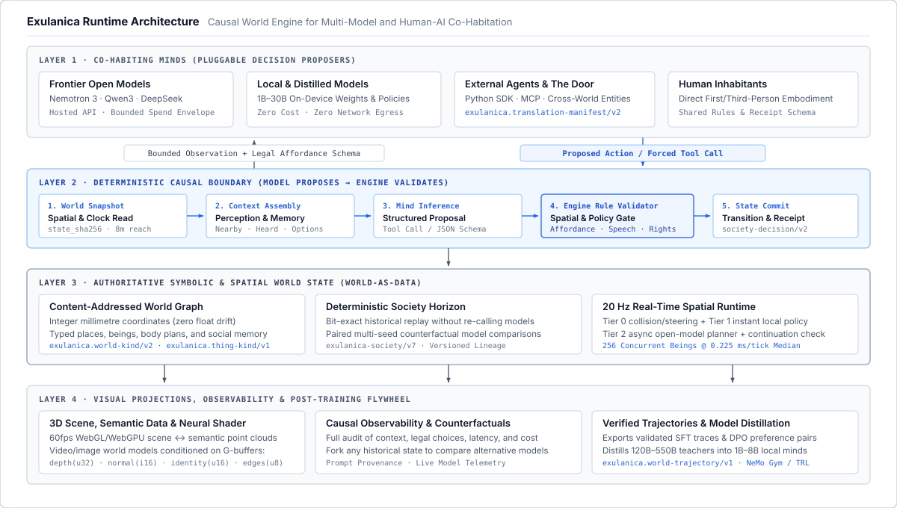

<p align="center">
  
</p>

<h1 align="center">Exulanica</h1>

<p align="center"><strong>Worlds for AI Agents.</strong></p>

<p align="center">
  <a href="https://exulanica.com">Website</a> ·
  <a href="docs/README.md">Documentation</a> ·
  <a href="docs/product-direction.md">Roadmap</a> ·
  <a href="#getting-started">Getting started</a>
</p>

<p align="center">
  <a href="https://github.com/twinkling-reality/exulanica/actions/workflows/check.yml"></a>
  <a href="LICENSE"></a>
  <a href="pyproject.toml"></a>
  <a href="web/package.json"></a>
</p>

Exulanica is Worlds for AI Agents. People create places and inhabitants, shape their
interactions, and develop worlds into projects they can explore and build on. Open models can
take the roles the engine registers. Comparing two models on the same saved world is one
capability.
[Product direction](docs/product-direction.md) owns scope, the first milestone, and the
hypothesis about discovering models through a world.

Hosted model calls go to Nebius Token Factory. The
[model manifest](exulanica/models/models.manifest.json) names the models, including NVIDIA
Nemotron, Qwen, and DeepSeek. Exulanica does not generate a world's appearance with a learned
model.

<p align="center">
  
  <br><sub>Product direction. The capability boundaries below distinguish implemented foundations from delivery targets.</sub>
</p>

## Models inside the world

A person builds a world. The things in it that act are its agents: people, animals, vehicles,
and decision-makers such as a shopkeeper. Open models can take the roles the engine registers.
Comparing two models on the same saved world is one capability. Exulanica does not generate a
world's appearance with a learned model.

A model is a proposer, not an authority. Two decision roles are registered: a person, and a
generated town's junction signal. Each role's contract declares what the model is shown and which
actions it may choose. The engine validates every choice before it takes effect, and every accepted
decision is stored, so a run replays without calling the model again and two runs from the same
saved world compare fairly. A junction signal may keep a green light one second longer or switch
to amber within its plan. No evaluation record measures whether that improves traffic, and no
improvement is claimed. Vehicles, animals, weather, and shopkeepers are not model roles. Every
hosted model call passes one policy boundary that enforces the egress allowlist, the budget, and
the person's rights.

Several open models serve hosted roles through that boundary (the
[model manifest](exulanica/models/models.manifest.json)). People in a starter or a world made
from photographs follow a deterministic planner until the owner chooses a model. A generated town
is a separate saved world. What the first milestone accepts, including generated towns and what
the Compare view runs, is the status table in
[product direction](docs/product-direction.md#first-milestone). Not built: roles beyond a person
and a junction signal; vehicles, weather, or an economy run by models; and a retraining loop.

## The world

The experience has six connected parts; [product direction](docs/product-direction.md) sets the
order they are delivered in:

<table>
  <tr>
    <td width="50%" valign="top">
      <h3>Models run your world</h3>
      Open models decide what the people in your world do: where to go, whether to wait, stand a while or stop to talk. The engine validates every decision and stores it, so a run replays exactly. The world's owner chooses the model for each person or group of people; with no choice, their routine decides.
      <p><a href="docs/capabilities/simulation.md">People and models</a> · <a href="docs/decision-roles-contract.md">Decision roles</a> · <a href="docs/model-and-service-selection.md">Model selection</a></p>
    </td>
    <td width="50%" valign="top">
      <h3>Swap a model, see the difference</h3>
      Run the same saved world's hour under two models and compare what happened. A comparison scores how the people fared against a control run and shows both runs side by side in the application, where the world's owner starts it within a spending bound they state and watches its runs finish.
      <p><a href="docs/society-experiments.md">Controlled comparisons</a> · <a href="docs/product-direction.md#first-milestone">First milestone</a></p>
    </td>
  </tr>
  <tr>
    <td valign="top">
      <h3>Build your world</h3>
      Place pieces from the catalogs, make a town from a served recipe, make a world from photographs, or import content with its origin labelled. Edits persist as versions. A starter and a world made from photographs each start with eight people. A generated town's people come from its homes.
      <p><a href="docs/capabilities/world-creation.md">World creation</a> · <a href="docs/capabilities/scene-reconstruction.md">Reconstruction</a></p>
    </td>
    <td valign="top">
      <h3>Give the world life</h3>
      The people in your world follow routines, walk to the places they use, and respond to what you change. Small birds fly and perch on the trees that host them, on a clock everyone watching shares. Pause and playback speed are clock controls. The <a href="docs/world-clock-contract.md">world clock contract</a> owns the rest of the clock. Calendar, weather, and fictional physics are not configurable.
      <p><a href="docs/synthetic-society-contract.md">Society contract</a> · <a href="docs/movement-modules-contract.md">Movement modules</a> · <a href="docs/product-direction.md#configurable-world-rules">World rules</a></p>
    </td>
  </tr>
  <tr>
    <td valign="top">
      <h3>Inspect the data</h3>
      Inspect a subject's geometry, properties, relationships and origin, and what an agent decided. Query, edit and extract supported world content as reusable data while keeping its identity across views.
      <p><a href="docs/atlas-reconstruction-inspection.md">Representation and inspection</a> · <a href="docs/capabilities/world-api.md">World API</a></p>
    </td>
    <td valign="top">
      <h3>The Companion and your photographs</h3>
      Features for building and understanding a world: the Companion is an AI partner that helps you explore, create and understand what happens, and your own photographs can become places and references in a world, under your rights and consent.
      <p><a href="docs/capabilities/companion.md">Companion</a> · <a href="docs/saved-world-entry.md#reference-photographs">Reference photographs</a></p>
    </td>
  </tr>
</table>

## The world as data

The architectural goal is **structured, addressable world state**: meaningful subjects and changes
have identities, properties, relationships, spatial context and history that people and programs
can inspect and act on. Supported geometry and records can be selected, queried and reused through
declared interfaces, with their origin and permissions preserved.

Meshes, tessellated surfaces, point clouds and Gaussian splats are representations of that state.
They do not by themselves provide semantic labels, complete object extraction or physical behavior.
A render vertex need not be a permanent database entity; a selectable object or consequential
change needs a stable record. This foundation lets different renderers, models and applications
work with the same world. See the [world state architecture](docs/world-memory-model.md).

## Capability boundaries

The repository supplies working components for this experience. Their contracts define the
supported operations; the full product direction is broader than those components.

| Area | Implemented foundation | Delivery target |
| --- | --- | --- |
| Models in the world | Open models in hosted roles through one policy boundary; a model chosen for a person or a group, or for a generated town's junction signal, validated, stored and replayed; comparisons of models started from the application within a stated bound, scored against a control and shown side by side | Roles beyond a person and a junction signal, and a retraining loop |
| Persistent worlds | Authored starter worlds, worlds made from reviewed photographs, saved versions, object edits and undo, appearance state, reference photographs | A complete personal-media-to-editable-world journey |
| Inspectable data | Supported point and surface representations, subject selection, structured records and source references | Complete reusable object extraction and consistent semantic coverage across sources |
| Companion | Grounded answers, including about a world's simulated people; conversation memory kept across reloads; reviewed appearance proposals | Shared activity, durable personal continuity and broader creation tools |
| Life and experiments | A starter or photograph world begins with eight people. A generated town's people come from its homes and are admitted by minute cost. Small birds and a generated town's vehicles share a clock. Paired experiments record specific interventions | Richer social behavior, configurable calendar and physics, and validated model-driven scenarios |
| Developer access | Authenticated world APIs, an independent Python client and signed partial world packages | General model adapters, dataset workflows and runnable interchange |

General model adapters, user-defined world rules and dataset generation are delivery targets.
The [experiment contract](docs/society-experiments.md) specifies one bounded application of the world:
paired society runs with supported interventions.
Synthetic outcomes do not establish predictions about real people or real-world systems.

## Architecture

A persistent world connects identity, spatial state, time, edits and recorded events. The browser,
Companion, model adapters and external clients work through declared interfaces. Observations,
authored content and simulation results retain distinct origins and meanings.

| Module | Responsibility | Reference |
| --- | --- | --- |
| World state | Identity, epistemic planes and representations; versions and edit history | [World state architecture](docs/world-memory-model.md) · [World objects](docs/world-objects-contract.md) |
| Creation and representation | Reconstruction, authored objects, appearance and browser rendering | [World composition](docs/world-composition-contract.md) |
| Simulation | Societies, the engines and routines that run them, movement modules and replayable outcomes | [Society contract](docs/synthetic-society-contract.md) · [Movement modules](docs/movement-modules-contract.md) |
| Models deciding | Decision roles as data, one validated decision path, comparisons of models | [Decision roles](docs/decision-roles-contract.md) · [Comparisons](docs/society-experiments.md#comparisons-of-models) |
| Model integration | Replaceable reconstruction, generation and decision providers behind one policy boundary, with validated outputs | [Model selection](docs/model-and-service-selection.md) · [Model manifest](exulanica/models/models.manifest.json) |
| API and portability | Authorized reads and edits; signed, capability-declared snapshots | [Developer client](docs/capabilities/developer-client.md) · [World package](docs/world-memory-package.md) |

Python and PostgreSQL carry the backend; TypeScript and PlayCanvas carry the browser experience.
The configured Companion answer path uses **NVIDIA Nemotron through Nebius Token Factory** to
compose answers from validated evidence. The open models a world's owner can choose for a person
are those the manifest records as verified to answer a choice. Other model roles support
perception, retrieval and reviewed proposals. The [model and service selection](docs/model-and-service-selection.md) describes
the implemented callers, evaluation evidence and hosting boundaries. This does not imply that the
whole application or its background workers are deployed on Nebius Serverless.

A world is structured, versioned state that models act in, not a single trained general-purpose
predictor. The portable format is named **World Memory Package** in its technical
contract; verifying a package does not by itself load a runnable world in another application.

## Getting started

### Browser preview

Requires Git, Node.js 22 or newer, and pnpm 10.7.1.

```bash
git clone https://github.com/twinkling-reality/exulanica.git
cd exulanica/web
pnpm install --frozen-lockfile
pnpm app
```

Open [http://localhost:5173/?preview=1](http://localhost:5173/?preview=1), or the address Vite
prints if that port is occupied, with `?preview=1` appended. This development preview uses fixture
data. It does not create an authenticated saved world or demonstrate media reconstruction, and
choosing or comparing the models that decide for a world's people needs the persistent application.

### Persistent application

The authenticated application uses a separate API, PostgreSQL, local asset storage and configured
accounts. Backend development requires Python 3.11 and [uv](https://docs.astral.sh/uv/);
reconstruction and processing use additional dependencies and workers.

Follow [development setup](docs/development-setup.md) for installation and services, and its
[people and models section](docs/development-setup.md#seeing-people-and-models-locally) to see
models decide in a local world; [account configuration](docs/deployment.md) for deployment
requirements; and [the Python client guide](docs/capabilities/developer-client.md) to build against
a configured API.

## Documentation

| Start here | Go deeper |
| --- | --- |
| [Product direction and delivery gates](docs/product-direction.md) | [Architecture overview](docs/architecture-overview.md) |
| [People and models in a world](docs/capabilities/simulation.md) | [Society contract](docs/synthetic-society-contract.md) · [Decision roles](docs/decision-roles-contract.md) |
| [Society experiments and comparisons](docs/society-experiments.md) | [Movement modules](docs/movement-modules-contract.md) |
| [Saved worlds](docs/saved-world-entry.md) | [Authored objects and behaviors](docs/world-objects-contract.md) · [World composition](docs/world-composition-contract.md) |
| [World API](docs/capabilities/world-api.md) | [Independent Python client](docs/capabilities/developer-client.md) |
| [Documentation hub](docs/README.md) | [Complete document catalog](docs/all-documents.md) |

For bugs and focused proposals, [open an issue](https://github.com/twinkling-reality/exulanica/issues)
with the relevant world operation, expected result and reproduction steps. Use the capability
contracts and [development guide](docs/development-setup.md) when contributing a change.

## License

[Apache-2.0](LICENSE). Model weights, datasets and third-party assets have their own terms;
see [third-party notices](THIRD_PARTY_NOTICES.md).

KayKit Adventurers 2.0 and KayKit Character Animations 1.1 by Kay Lousberg are used under CC0
([asset credits](assets/things/kaykit-adventurers-2)). A Luanti player's look is built at deployment
from the operator's copy of Minetest Game's default player picture (character.png by Jordach,
CC BY-SA 3.0); that picture is not committed.
